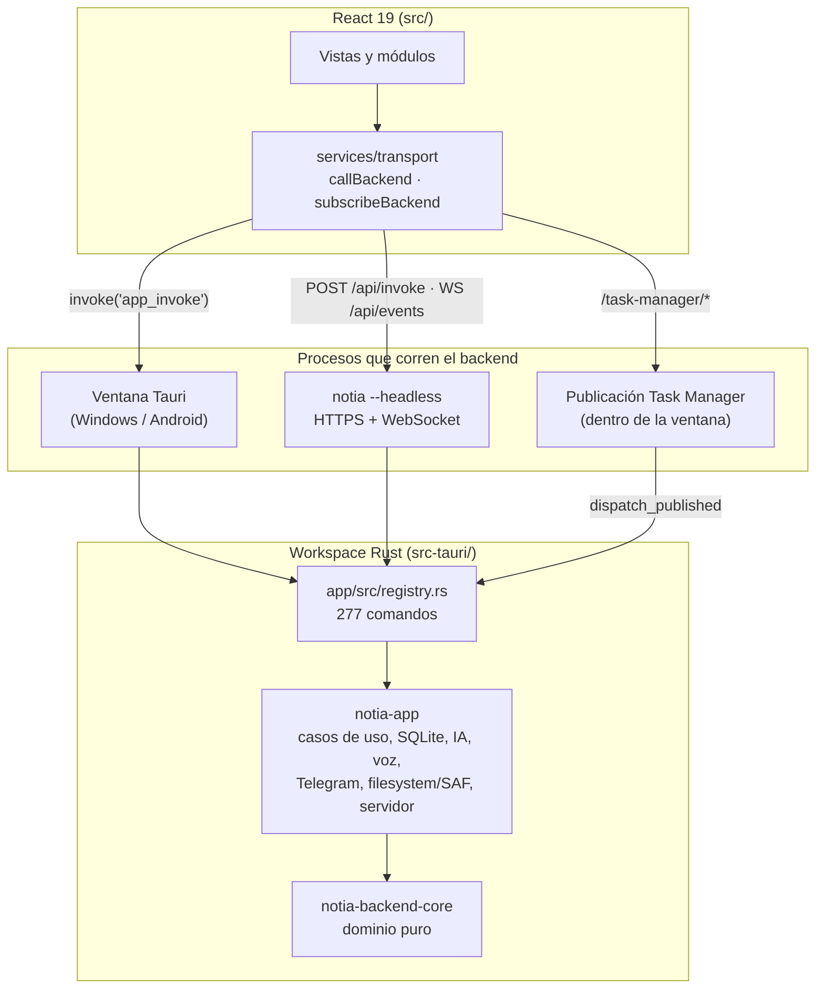

# Notia: qué es, qué hace y cómo levantarlo

> Guía escrita el 2026-11-11 sobre la rama `claude/compassionate-hopper-wvc4xx`, partiendo del commit `4e79b65` (versión `1.0.12` de `package.json`).
> Cuando digo **verificado** es porque lo ejecuté en un Linux limpio (Ubuntu 24.04, Node 22.23, Rust 1.97, sin WebKitGTK). Cuando digo **deducido del código** es porque lo leí en el código y no lo pude ejecutar. No mezclo las dos cosas.

---

## 0. Resumen corto

- **Qué es:** una app de notas y "segundo cerebro" *local-first* (estilo Obsidian) que fue creciendo hasta ser casi un sistema operativo personal: notas Markdown, Task Manager con Gantt, finanzas, salud, gimnasio, recetas, agenda, gestor de contraseñas, grabación y transcripción de reuniones, y un asistente de IA con unas 240 herramientas que opera todo eso desde la app, Telegram, WhatsApp o un webhook.
- **Con qué está hecha:** Tauri 2. Usa React 19 + TypeScript como "cáscara visual" y Rust para **toda** la lógica. Son unas 196.000 líneas de Rust, unas 112.000 de TypeScript y 40.000 de CSS. El backend expone 277 comandos.
- **Plataformas reales:** Windows (escritorio) y Android. El backend también corre como **servidor sin ventana** (`notia --headless`) en Windows y Linux, y se usa desde el navegador. Que diga "soporta macOS y Linux" es más una aspiración que un hecho: la ventana de escritorio en Linux o macOS **no compila con un clone recién hecho** (ver [§6.7](#67-ventana-en-linux-o-macos-por-qué-no-anda-de-fábrica)).
- **La forma más rápida de verlo andando:** el servidor headless más el navegador; con `--data-root` todo lo que guarda queda en una sola carpeta. Lo levanté en Linux de punta a punta ([§6.4](#64-camino-b-servidor-headless--navegador-verificado-en-linux)).
- **La forma "oficial" (ventana en Windows):** pide bajar unos 2 GB de modelos de voz y compilar dos runtimes nativos en C++ con el Vulkan SDK. Sin eso, el build de Rust falla a propósito.
- **Lo que encontré roto** (detalle en [§9](#9-problemas-e-inconsistencias-que-encontré)):
  - `npm run lint` falla con 4 errores.
  - Falla 1 test de Rust: el filtro que debería bloquear imágenes sexuales de menores **no existe**, y el modelo de imágenes es una versión "uncensored". Es serio.
  - El servidor headless no podía abrir una biblioteca nueva (ya corregido).
  - La documentación tiene datos desactualizados: URL de IA por defecto, versión, cantidad de comandos y pasos de Android que faltan.

---

## 1. Qué es Notia

Notia organiza **carpetas de tu disco como "bibliotecas"**. Las notas son archivos `.md` comunes y los datos estructurados (finanzas, agenda, usuarios, etc.) van en un SQLite **dentro de la misma carpeta** (`.notia/notia.db`). No usa servidor en la nube ni cuentas: si copiás la carpeta, copiás todo.

Encima de eso hay un **asistente de IA** (vía Ollama, local o en la nube) que puede leer y modificar la biblioteca con confirmación: crear notas, mover tickets, cargar gastos a partir de la foto de un ticket, agendar, mandar mails, responder WhatsApp y ejecutar comandos en la terminal de la PC. Cada cambio pasa por una vista previa y confirmación, y se verifica después de guardarlo.

La filosofía declarada (README) es *local-first*, *offline-first* y *privacy-first*. Ojo con los matices:
- La **IA por defecto apunta a Ollama Cloud** (`https://ollama.com`), no a un Ollama local (ver §9).
- Varias funciones necesitan internet de forma inherente: Telegram, Gmail, Google Calendar, WhatsApp, búsqueda web, cotizaciones del dólar, clima y la descarga de modelos.
- Lo que sí es 100 % local: notas, base de datos, cifrado de ColdPass, transcripción de voz (Whisper corre en tu equipo) y generación de imágenes (corre en tu GPU).

Es un proyecto de un solo autor (todos los commits visibles son de la misma persona), muy activo y documentado con un nivel de detalle obsesivo: `README-TECH.md` pesa 1,5 MB.

---

## 2. Funciones, por módulo

El inventario completo y actualizado es [`FUNCIONALIDADES.md`](../FUNCIONALIDADES.md) (138 ítems). Acá va agrupado para entenderlo:

| Módulo | Qué hace |
|---|---|
| **Inicio** | Tablero de la biblioteca: agenda de 7 días, tareas urgentes, Pomodoro, mes de Finanzas y dólar, hábitos, clima (Open-Meteo), chats y notas para retomar. |
| **Explorador y bibliotecas** | Árbol de archivos con búsqueda (`Ctrl+O`), nueva nota (`Ctrl+N`), contexto por carpeta y varias bibliotecas. En Android usa SAF (`content://`). |
| **Editor Markdown** | Milkdown/Crepe WYSIWYG con wikilinks `[[nota]]`, propiedades y frontmatter editables, cadenas `nextPage`/`previousPage`, bloques estilo GitBook, Mermaid, XGraph (JSXGraph), fórmulas KaTeX, bloques dentro de tablas, **modo página** (hojas A3) y **escritura a mano** con lápiz, borrador, lazo y conversión a texto/LaTeX/Mermaid por IA. Exporta a PDF y DOCX. |
| **Mermaid** | Editor visual de `.mmd` (flujo, secuencia, estados, clases, ER) con el código sincronizado. Exporta PNG/SVG. |
| **Graph View** | Grafo 2D de las relaciones entre notas, coloreado por contexto (`#Laboral`, `#Personal`, `#Confidencial`…), con filtros y minimapa. |
| **Chat IA** | Chat con historial, adjuntos (texto hasta 10 MB, imágenes, PDF), RAG sobre la biblioteca, hasta 6 agentes conversando entre sí, permisos por chat y modo "sin memoria". Hay un chat lateral contextual en cada vista. |
| **Memoria del agente** | Archivos en `.agent/memory/`: `memory.md`, `rules.md`, `thoughts.md`, `biography.md` (tu biografía "como libro"), `talk.md` (cómo hablás), `people.md` e `improve.md`. Los escribe solo la IA y se reorganizan en segundo plano. |
| **Task Manager** | Tableros con columnas tipadas (Sprint actual, Bloqueado, etc.), vistas Tablero, Lista y Management (Gantt, ruta crítica, CPM), subtareas, comentarios, cronómetro y Pomodoro. Se puede **publicar en la red local** por HTTPS con login por usuario. |
| **Finanzas** | Seguimiento informal que **carga el asistente**, no la pantalla: le mandás la foto del ticket, el recibo de sueldo o el resumen de tarjeta y concilia todo (cuotas, servicios, ahorro en USD). Usa cotizaciones de DolarApi e IPC de ArgentinaDatos. Está muy orientado a Argentina. |
| **Agenda y Rutina** | Calendario con bloques de 15 minutos, feriados argentinos, sincronización bidireccional con Google Calendar y hábitos con rachas y "rueda de la vida". |
| **Salud, Gimnasio y Recetas** | Peso, IMC, comidas (también desde una foto), agua, pasos, sueño y composición corporal. Rutinas de gimnasio con fichas de ejercicios. Recetario con macros y micronutrientes, que completa la IA. |
| **ColdPass** | Gestor de contraseñas cifrado (AES-256-GCM) con la contraseña del Owner, con generador, huella en Android, sincronización por Bluetooth y extensión de Chrome que autocompleta. |
| **Meeting** | Graba micrófono y audio del sistema (Windows), transcribe en vivo **offline** con Whisper large-v3-turbo, separa hablantes, hace una segunda pasada con large-v3 en GPU y genera "Notas IA" cada 5 minutos. También transcribe archivos de audio y video. La extensión de Chrome lee los nombres en llamadas de Teams. |
| **Voz** | Dictado offline (Whisper) y lectura en voz alta (Qwen3-TTS). |
| **Imágenes** | Genera y edita imágenes con Qwen-Image 2.1 Turbo en la GPU de la PC (`stable-diffusion.cpp`). Ver la advertencia de seguridad en §9. |
| **Acciones IA y Tareas IA** | Acciones: recordatorios y tareas programadas que la IA ejecuta y te contesta por Telegram. Tareas: trabajos largos con Planificador, Ejecutor y Review, con aprobaciones y esperas de hasta 30 días. |
| **Integraciones** | Telegram (bot privado), WhatsApp (Baileys, por QR), Gmail (hasta 10 cuentas) y Google Calendar (OAuth con tu propio proyecto de Google Cloud), webhook `POST /webhook`, terminal de la PC, navegador con Playwright y scripts Python propios en `.agent/scripts`. |
| **Multi-dispositivo** | Modo **Host/Cliente**: el host sirve la biblioteca por el puerto 52480 y los clientes (Android u otra PC) trabajan sobre una copia y sincronizan (gana el cambio más reciente). Además hay **servidor headless** y **espacios públicos** de solo lectura estilo GitBook. |
| **Usuarios** | Roles (Owner, Family, Guest) y usuarios por biblioteca, cada uno con sus contextos permitidos. La configuración de la biblioteca se cifra con la contraseña del Owner, **sin recuperación** si la perdés. |

---

## 3. Cómo está construido

### 3.1 La regla de oro

`CLAUDE.md` lo dice sin vueltas: **toda la lógica vive en Rust y React es solo una cáscara visual**. El frontend manda una intención (`callBackend('comando', args)`) y muestra lo que vuelve. Hay una regla de ESLint que prohíbe importar `@tauri-apps/*` fuera de `src/services/transport/` y `src/services/window/`.

### 3.2 Diagrama



### 3.3 Crates de Rust

| Crate | Ruta | Rol |
|---|---|---|
| `notia` | `src-tauri/` | Binario. La feature `app` (por defecto) incluye la ventana Tauri; sin ella (`--no-default-features`) solo existe el modo `--headless`. |
| `notia-app` | `src-tauri/app/` | Casos de uso, estado, adaptadores (filesystem de escritorio y SAF de Android, SQLite, Ollama, voz, Telegram, Bluetooth), registro de comandos y servidor HTTPS. **No depende de Tauri.** |
| `notia-backend-core` | `src-tauri/backend-core/` | Dominio puro: agente, prompts, 241 esquemas de herramientas (`defaults/tool_schemas.json`), Task Manager, finanzas, exportación PDF/DOCX, etc. |

Agregar un comando = escribir la función en `notia-app`, sumarla al `match` y a `COMMAND_NAMES` en `registry.rs`, y llamarla con `callBackend` desde TypeScript. No hay `#[tauri::command]`.

### 3.4 Frontend

| Carpeta | Qué hay |
|---|---|
| `src/main.tsx` | Arranque: si hay ventana nativa carga `WindowApp`; si no (navegador), `RemoteApp`, que pide login al servidor headless. |
| `src/components/notia/` | Shell: rail, explorador, pestañas, vistas (Home, Graph, Chat, Meeting, Finanzas…). |
| `src/modules/` | Módulos grandes: `task-manager`, `finance`, `agenda`, `gym`, `health`, `recipes`, `mermaid`, `inkmath`, `ai-tasks`, `ai-actions`, `public-space`, `markdown-export`. |
| `src/services/` | Clientes finos del backend por área, `transport/` y `window/`. |
| `src/store/` + `src/features/` | Redux Toolkit, solo para estado de UI. |
| `public-task-manager.html`, `public-space*.html` | Entradas extra de Vite para el Task Manager publicado y los espacios públicos. |

Las dependencias más pesadas son Milkdown/Crepe, Monaco, Mermaid, KaTeX, pdf.js, react-force-graph-2d, MUI y Lucide. El build genera unos 20 MB en `dist/`.

### 3.5 Puertos

| Puerto | Qué |
|---|---|
| 1420 / 1421 | Vite dev server y HMR (solo en desarrollo). |
| 52480 | Modo Host y servidor headless (HTTPS, certificado autofirmado). |
| 52485 | Webhook (por defecto). |
| 52490 en adelante | Espacios públicos, uno por puerto. |
| configurable | Publicación del Task Manager (se elige en Configuraciones → Publicar). |

---

## 4. Dónde viven los datos

### 4.1 La biblioteca (tu carpeta)

Esto es lo que quedó en una biblioteca de prueba después del primer login (verificado):

```
MiBiblioteca/
├── Notas/…                    ← tus .md
├── .notia/
│   ├── notia.db               ← SQLite: usuarios, finanzas, agenda, rutina, salud…
│   ├── notiaConfig.json       ← configuración (IA, Telegram, contextos), CIFRADA con la contraseña del Owner
│   ├── ink/                   ← trazos a mano por nota
│   └── meetings/              ← índice de reuniones
├── .agent/
│   ├── memory/                ← memory.md, rules.md, thoughts.md, biography.md, talk.md, people.md, improve.md
│   ├── promps/                ← prompts del agente (sí, "promps", sin t)
│   ├── dynamics/  skills/  scripts/
├── chat/chats/                ← historial de chats en Markdown
├── task-mannager/             ← tableros (el nombre principal tiene doble "n" en el código; también acepta task-manager/)
├── recipes/  Gym/  ColdPass/  Meetings/
```

### 4.2 Datos de la aplicación (por equipo)

- Windows: `%APPDATA%\com.gabriel.notia\`
- Linux: `~/.local/share/com.gabriel.notia/`

Ahí quedan el catálogo de bibliotecas, `connection.json` (modo Host o Cliente), `notia.lock` y `headless-server/` (hash de la contraseña del servidor y certificado TLS). **La ventana y el servidor headless comparten esta carpeta y se bloquean entre sí:** no pueden correr a la vez sobre los mismos datos ("Notia ya está en uso").

---

## 5. Servicios externos: qué necesitás para cada uno

Nada de esto hace falta para abrir la app y editar notas.

| Función | Qué necesita |
|---|---|
| Chat IA y todo lo "inteligente" | **Ollama**. Por defecto `https://ollama.com` (Ollama Cloud) con API key de ollama.com. Para usar uno local: instalar Ollama, `ollama pull <modelo>` y poner `http://localhost:11434` en Configuraciones → IA. El modelo tiene que soportar *tool calling*. Para imágenes: que también tenga visión, o elegir un **Modelo para imágenes** aparte en Configuraciones → IA, que las lee y le pasa el texto. |
| Búsqueda web del asistente | **Solo con Ollama Cloud** (`/api/web_search`). El código rechaza explícitamente `localhost`. |
| Telegram | Un bot de @BotFather con su token, configurado en la PC que corre los servicios. Se vincula con `/start` + usuario + contraseña de la biblioteca. Nunca corre en Android. |
| Gmail y Google Calendar | Un proyecto propio de Google Cloud con credenciales OAuth (se cargan o importan del JSON en Configuraciones → Cuentas). |
| WhatsApp | **Node.js en la PC host.** Notia instala sola `baileys@7.0.0-rc14` (más `qrcode`) con npm la primera vez y se vincula por QR. |
| Navegador del asistente | Node.js más Chrome o Edge instalado (`playwright-core@1.64.1` se instala solo con npm). |
| Scripts del asistente | Python 3 en la PC. |
| Extracción de documentos con LlamaCloud (opcional) | Variable de entorno `LLAMA_CLOUD_API_KEY` en el entorno donde arranca Notia. |
| Dólar, IPC, feriados y clima | Internet (DolarApi, ArgentinaDatos, Open-Meteo). |
| Imágenes (Qwen-Image) | Windows con GPU Vulkan, el runtime `sd-cli` compilado y unos GB de modelos que se bajan desde Configuraciones → Imágenes (Hugging Face). |
| Voz (dictado, Meeting) | Modelos Whisper, el runtime `whisper.cpp` compilado y **el runtime de sherpa-onnx 1.13.4 (VAD y diarización), que ningún script provee** (ver §6.5). |

---

## 6. Cómo levantarlo

### 6.1 Elegí el camino

| Camino | Para qué | SO | Dificultad | ¿Lo probé? |
|---|---|---|---|---|
| **A. Build y tests del frontend** | Ver si compila, correr tests, tocar UI | Cualquiera | Baja | ✅ Verificado |
| **B. Servidor headless + navegador** | **Ver la app andando rápido**, con casi todas las funciones | Linux o Windows | Media | ✅ Verificado en Linux |
| **C. Ventana de escritorio en Windows** | La experiencia completa (voz, Meeting, bandeja, publicación) | Windows | **Alta** | ❌ Deducido del código y los scripts |
| **D. Android** | La app en el teléfono o la tablet | Windows como máquina de build (en la práctica) | **Muy alta** | ❌ Deducido |
| E. Ventana en Linux o macOS | — | — | No anda de fábrica | ❌ Ver §6.7 |

**Mi recomendación:** empezá por **B** para ver qué es y si te interesa. Pasá a **C** solo si vas a desarrollar sobre Windows.

### 6.2 Requisitos comunes

- **Git** y **Git LFS**: los modelos de diarización (`*.onnx`) están en LFS. Sin `git lfs pull` son archivos de 130 bytes.
- **Node.js 20.19+ o 22.12+** (Vite 7 no arranca con versiones más viejas) y npm 10+. El README dice "Node 20+", que es impreciso. Yo usé Node 22.23.
- **Rust estable ≥ 1.89** (el código usa `File::try_lock`, estabilizado en 1.89). Yo usé 1.97.
- Disco: `node_modules` más `target/` de Rust ocupan varios GB; el binario debug pesa 545 MB.

```bash
git clone https://github.com/leaa37/notia.git
```

```bash
cd notia
```

```bash
git lfs install
```

```bash
git lfs pull
```

```bash
npm ci
```

> `npm ci` respeta el lockfile, incluido el *override* de `esbuild 0.27.7`, que evita un crash conocido en Windows (`STATUS_ACCESS_VIOLATION`).

### 6.3 Camino A: build y tests del frontend (verificado)

```bash
npm run build
```

```bash
npx vitest run
```

```bash
npm run lint
```

Resultados al 2026-11-11:
- `npm run build`: ✅ compila (~32 s; avisa chunks grandes, el de iconify pesa 6,4 MB).
- `vitest`: ✅ **148 archivos, 753 tests, todos pasan**. Muestra ruido de `happy-dom` intentando hacer fetch a `localhost:3000`, pero no falla.
- `lint`: ❌ **4 errores** (ver §9).

> `npm run dev` solo levanta Vite en `http://127.0.0.1:1420`. **Por sí solo no sirve para usar la app**: sin ventana Tauri, la interfaz entra en modo navegador y busca el servidor en el mismo origen (`/api/health`), que Vite no tiene. Para eso está el camino B.

### 6.4 Camino B: servidor headless + navegador (verificado en Linux)

El mismo backend corre sin ventana y sirve la interfaz web por HTTPS. En Linux no necesita WebKitGTK ni D-Bus, solo un compilador C (`build-essential`), porque SQLite y `ring` se compilan desde fuente.

**1. Compilar el frontend y el binario servidor.** Desde la raíz:

```bash
npm run build
```

```bash
cd src-tauri && cargo build --no-default-features
```

En debug tarda unos 3 minutos con 4 núcleos (los crates ya descargados) y genera 141 warnings, sin errores. Para un binario optimizado, `cargo build --release --no-default-features`, que tarda bastante más por el LTO. El binario queda en `src-tauri/target/debug/notia` (o `release/`).

En **Windows** podés usar el mismo `notia.exe` de la app de escritorio con `--headless`, o compilarlo igual que en Linux.

**2. Definir la contraseña del servidor** (8 a 256 caracteres):

```bash
NOTIA_OWNER_PASSWORD='una-contraseña-larga' ./target/debug/notia --headless --set-owner-password
```

**3. Agregar una biblioteca** (cualquier carpeta):

```bash
./target/debug/notia --headless --add-library /ruta/a/MiBiblioteca
```

Agregar la carpeta ya crea su `.notia/` con la base de datos. Antes, una carpeta que Notia nunca había abierto fallaba en el primer login; está corregido, ver §9.

**4. Arrancar el servidor sirviendo la interfaz:**

```bash
./target/debug/notia --headless --static-dir ../dist --bind 127.0.0.1:52480
```

Para usarlo desde otros equipos de la red, cambiá la dirección por `--bind 0.0.0.0:52480`, que es el valor por defecto. Las opciones completas se ven con `--help`: `--data-root`, `--data-dir`, `--resource-dir`, `--static-dir`, `--bind`, `--set-owner-password` y `--add-library`.

> **Todo en una carpeta:** con `--data-root <carpeta>` en lugar de `--data-dir` y `--add-library`, los datos de Notia van a `<carpeta>/app` y cada subcarpeta de `<carpeta>/bibliotecas` es una biblioteca, que se registra sola al arrancar (si no hay ninguna, crea `Biblioteca`).

**5. Abrir `https://127.0.0.1:52480/`.** El certificado es autofirmado, así que hay que aceptar la excepción del navegador. Después hay **dos logins seguidos**:
1. **"Contraseña del dueño"**: la del paso 2 (es la del servidor).
2. **"Iniciar sesión" de la biblioteca**: la primera vez dejá activado **"Primer inicio"**, escribí el usuario **`Owner`**, tocá **Continuar** y creá su contraseña (mínimo 8 caracteres, **sin recuperación**). Después entrás con `Owner` y esa contraseña.

Con eso ves el shell completo: explorador, editor, chat, Task Manager, Finanzas, etc. Lo verifiqué con Playwright: tanto el login como la pantalla principal cargan sin errores de JavaScript.

**Qué NO hay en modo navegador:** Meeting, Bluetooth de ColdPass, importar un vault CSV, elegir la carpeta de backups y agregar bibliotecas con selector (se hace con `--add-library`). En Linux tampoco hay dictado ni transcripción de audios de Telegram, porque no hay reconocedor de voz compilado.

> **glibc:** el binario pide la glibc del sistema donde se compiló, o una más nueva. Compilado en Debian 13 no arranca en Debian 12 (`GLIBC_2.38 not found`): compilalo en la misma versión de la distribución donde va a correr, o en una anterior.

### 6.5 Camino C: ventana de escritorio en Windows (el camino "oficial")

**Deducido del código y los scripts. No lo pude ejecutar.** El orden importa porque `src-tauri/build.rs` y `tauri-build` **fallan el build a propósito** si faltan modelos o runtimes.

#### Requisitos de Windows

- Windows 10/11 x64, con WebView2 (ya viene en Windows 11).
- **Visual Studio 2022 Build Tools** con "Desarrollo para el escritorio con C++". Los `.cmd` de `scripts/` lo buscan con `vswhere` y abortan si no está.
- Rust con toolchain **MSVC** (`x86_64-pc-windows-msvc`).
- **CMake ≥ 3.22** y el **Vulkan SDK** (variable `VULKAN_SDK` definida), para compilar `whisper.cpp` y `stable-diffusion.cpp`.
- **Git Bash**, para correr `install-speech.sh` (usa `curl` y `sha256sum`).
- Opcional: CUDA, solo para Qwen3-TTS en GPU.

#### Pasos

Además de lo de §6.2:

1. **Submódulos nativos** (`whisper.cpp`, `stable-diffusion.cpp` y `qwen3-tts.cpp`):

```bash
git submodule update --init --recursive
```

2. **Modelos de voz** (~1,9 GB: Whisper large-v3-turbo q8, Silero VAD y Whisper large-v3 q5), desde Git Bash:

```bash
bash scripts/install-speech.sh
```

3. **Runtime de whisper.cpp** con Vulkan, que genera `src-tauri/resources/whisper/runtime/windows-x86_64/`:

```bash
powershell -ExecutionPolicy Bypass -File scripts/build-whisper-runtime.ps1 -Platform windows
```

4. **Runtime de stable-diffusion.cpp** (`sd-cli.exe`, para imágenes). Es obligatorio porque `tauri.conf.json` lo lista como recurso y un *glob* vacío rompe el build:

```bash
powershell -ExecutionPolicy Bypass -File scripts/build-stable-diffusion-runtime.ps1
```

Los dos scripts compilan en `C:\notia-native-build\`, en la raíz del disco y fuera del repo.

5. **Arrancar en modo desarrollo:**

```bash
npm run dev:tauri:windows
```

Esto carga el entorno de VS, hace un build multipágina sin minificar (lo necesita la publicación del Task Manager), deja un `vite build --watch`, levanta Vite en 1420 (o reutiliza el de este repo) y lanza `tauri dev`. Si el puerto 1420 lo ocupa otro proceso, se niega a arrancar.

6. **Build de release** (instalador):

```bash
npm run build:tauri:windows
```

#### Opcionales: sin esto compila, pero esas funciones no andan

- **Qwen3-TTS** (lectura en voz alta): `scripts/build-qwen3-tts-runtime.ps1 -Platform windows [-Device gpu]` y `scripts/install-qwen3-tts-models.ps1` (~860 MB).
- **sherpa-onnx 1.13.4** (`sherpa-onnx-c-api.dll` + `onnxruntime.dll` en `src-tauri/resources/speech/runtime/windows-x86_64/`). **Ningún script lo provee** y el README de esa carpeta solo dice que "la distribución debe colocarlo". El reconocedor de voz carga esa DLL para el VAD y la diarización, así que **sin ella no esperes que el dictado ni Meeting funcionen**, aunque todo lo demás compile. Hay que bajarlo de los releases de sherpa-onnx a mano.

#### Atajo no oficial para "solo quiero ver la ventana" (no verificado)

Si no querés instalar el Vulkan SDK ni bajar 2 GB, el build solo comprueba que **existan** ciertos archivos (`build.rs` usa `is_file()` y `tauri-build` exige que cada *glob* de recursos encuentre algo). En teoría, con archivos de relleno compila y la voz y las imágenes quedan inutilizables, porque los modelos se validan con SHA-256 al cargarse:

```
src-tauri/resources/speech/models/whisper-large-v3-turbo/ggml-large-v3-turbo-q8_0.bin   (relleno)
src-tauri/resources/speech/models/whisper-large-v3-turbo/silero_vad.onnx               (relleno)
src-tauri/resources/speech/models/whisper-large-v3/ggml-large-v3-q5_0.bin              (relleno)
src-tauri/resources/whisper/runtime/windows-x86_64/.placeholder
src-tauri/resources/stable-diffusion/runtime/windows-x86_64/.placeholder
```

Esto **no lo probé en Windows**: lo deduje de `build.rs` y del código de `tauri-build 2.5.6`. Tampoco sé si la precarga de voz al iniciar tolera bien un modelo falso (debería loguear un error y seguir). **No commitees esos archivos.**

### 6.6 Camino D: Android

**Deducido. No lo ejecuté.** Es el camino más frágil:

- Requiere Android SDK, **NDK**, JDK 17 o 21 (`JAVA_HOME`), el target de Rust `aarch64-linux-android` (`rustup target add aarch64-linux-android`) y un dispositivo arm64 conectado por `adb`. Los scripts detectan el NDK y el dispositivo.
- **El proyecto Android no está generado en el repo** (`src-tauri/gen/android` solo tiene un `.kt`). Antes de `npm run dev:android` hay que correr una vez el comando de abajo. El README no lo menciona; solo lo hacen los scripts de release de Windows y `open-android-studio.sh`.

```bash
npm run tauri android init
```

- `build.rs` **hace `panic`** si falta `src-tauri/resources/whisper/runtime/android-arm64-v8a/libnotia_whisper.so`. Se genera con `scripts/build-whisper-runtime.ps1 -Platform android`, un script PowerShell que busca `ninja.exe` dentro del CMake del Android SDK y usa `LOCALAPPDATA`. Está escrito para **Windows**: en Linux o macOS vas a tener que adaptarlo.
- Los modelos también se empaquetan en el APK (~900 MB de Whisper turbo, más diarización y Qwen3-TTS según `tauri.android.conf.json`).
- Comandos: `npm run dev:android`, `npm run build:android:debug`, `npm run build:android:release` y `npm run build:android:aab`. El release firma con `android-signing.properties` (copiá `android-signing.properties.example`) o con las variables `NOTIA_ANDROID_KEYSTORE_*`. Los APK quedan en `builds/android/`.

### 6.7 Ventana en Linux o macOS: por qué no anda de fábrica

`npm run dev:tauri` existe (`scripts/tauri-dev-linux.sh`, que detecta Wayland o X11) y el README lista los paquetes `apt` y `dnf` de WebKitGTK. Pero `src-tauri/tauri.conf.json` declara como recursos, **para todas las plataformas de escritorio**:

```
resources/whisper/runtime/windows-x86_64/**/*
resources/stable-diffusion/runtime/windows-x86_64/**/*
resources/speech/models/whisper-large-v3/**/*
```

`tauri-build` aborta con *"glob pattern … path not found or didn't match any files"* si alguno no encuentra archivos. Lo confirmé en `tauri-utils 2.8.3`, `resources.rs`. Los dos primeros son DLL de Windows que solo se generan con scripts PowerShell de Windows, así que en Linux o macOS la ventana **no compila** sin el atajo de archivos de relleno de §6.5. Además, la propia tabla de plataformas de `README-TECH.md` no incluye "ventana Linux" ni "ventana macOS". **Para Linux, usá el camino B.**

---

## 7. Primer uso dentro de la app

1. **Biblioteca:** abajo a la izquierda, selector de biblioteca → *Administrar librerías* → *Agregar librería* y elegís una carpeta. En el navegador headless se agrega con `--add-library`.
2. **Owner:** la primera vez de cada biblioteca, *Primer inicio* con el usuario `Owner` y creás su contraseña. **Si la perdés, la configuración cifrada (`.notia/notiaConfig.json`) no se puede recuperar.**
3. **IA:** Configuraciones → IA. Usá la URL por defecto (Ollama Cloud) con API key, o `http://localhost:11434` con un Ollama local. Tocá *Verificar conexión* y elegí un modelo con *tool calling*.
4. **Rail izquierdo:** un ícono por módulo (Inicio, Explorador, Grafo, Chat, Task Manager, ColdPass, Meeting, Finanzas, Agenda, Rutina, Salud, Gimnasio, Recetas, entre otros). Abajo están Ayuda y Configuración.
5. **Varios dispositivos:** Configuraciones → General → *Modo de ejecución* (Host o Cliente, puerto 52480).

---

## 8. Validaciones que corrí (2026-11-11, Linux)

| Comando | Resultado |
|---|---|
| `npm ci` | ✅ |
| `npm run build` (`tsc -b && vite build`) | ✅ (warnings de tamaño de chunks) |
| `npx vitest run` | ✅ 148 archivos y 753 tests aprobados |
| `npm run lint` | ❌ 4 errores |
| `cargo build --no-default-features` (servidor) | ✅ 141 warnings en `notia-app` |
| `cargo test -p notia-backend-core` | ❌ 817 aprobados, **1 fallido**, 7 ignorados |
| Servidor headless + Playwright (login del servidor, primer inicio del Owner, pantalla principal) | ✅ (al principio, con el workaround de `.notia/`; después se corrigió el bug) |
| Ventana de escritorio (cualquier SO) | No ejecutada: este entorno no tiene WebKitGTK ni es Windows |
| `cargo test -p notia-app` | No ejecutado |
| Android | No ejecutado |

---

## 9. Problemas e inconsistencias que encontré

Ordenados por gravedad.

1. **🔴 La generación de imágenes no tiene ningún filtro contra contenido sexual con menores.** El test `image_generation::tests::only_sexual_content_with_minors_is_refused` (`src-tauri/backend-core/src/image_generation.rs`) espera que prompts como "niña desnuda" se rechacen con `Forbidden`, pero `generate_job` y `edit_job` **no validan nada**: el test falla con el primer caso. La función `fold` que seguramente iba a usarse para normalizar el texto quedó sin uso (el compilador avisa `fn fold is never used`). Y el modelo que se descarga es `Qwen-Image-2.1-Turbo-Abliterated-Uncensored`. En criollo: el único freno que el propio autor quiso poner **no está implementado**, y el test que lo dice está en rojo. Esto hay que arreglarlo antes de cualquier otra cosa.
2. **✅ Corregido el 2026-11-11: el servidor headless no inicializaba una biblioteca nueva.** `--add-library` registraba la carpeta pero no creaba `.notia/`, y el login llama a `open_library_connection`, que no crea la carpeta padre. Resultado: *"No se pudo abrir SQLite: unable to open database file"*. Ahora registrar una biblioteca deja su base lista (ver «Servidor con carpeta única de datos» en `README-TECH.md`).
3. **🟠 `npm run lint` falla** con 4 errores, aunque `README-TECH.md` registra validaciones en verde:
   - `react-refresh/only-export-components` en `MeetingCompletedPanel.tsx:427` y `MermaidCodePane.tsx:46`;
   - `react-hooks/refs` ("Cannot access refs during render") en `useMeetingAiContext.ts:38` y `MermaidStage.tsx:88`.
4. **🟡 La documentación dice que la IA por defecto es `http://localhost:11434`.** El código (`backend-core/src/ai_settings.rs`) usa **`https://ollama.com`** (Ollama Cloud) y trata URLs viejas como "usar el default". Para un proyecto que se vende como *privacy-first*, que el default mande tus prompts a la nube no es un detalle menor.
5. **🟡 Builds que dependen de Windows:** la ventana de Linux o macOS no compila de fábrica y el runtime de whisper para Android solo se genera con un script de Windows (§6.6, §6.7). El README dice "soporte multiplataforma para Windows, macOS, Linux y Android".
6. **🟡 Falta un runtime sin instrucciones:** sherpa-onnx (VAD y diarización) es necesario para la voz y no hay script ni enlace para conseguirlo (§6.5).
7. **🟡 `tauri android init` no está documentado** como paso previo a `npm run dev:android`.
8. **⚪ Detalles de documentación:**
   - el badge del README dice `1.0.13`, pero `package.json` y `tauri.conf.json` dicen `1.0.12`;
   - `README-TECH.md` habla de "202 comandos" y hay 277;
   - "Node 20+" es impreciso (Vite 7 exige 20.19+);
   - en la raíz hay un archivo vacío llamado `EOF`, casi seguro un heredoc mal cerrado.
9. **⚪ Peso de la documentación:** `README-TECH.md` tiene 13.378 líneas en un solo archivo, con secciones "Estado sincronizado de esta iteración" apiladas por fecha. Es más un diario de desarrollo que una referencia. Para orientarte, leé primero la sección **"Arquitectura vigente: backend Rust, hosts y transporte"** (al principio) y **"1. Documentación General"** (~línea 2550).

---

## 10. Por dónde empezar a leer el código

| Querés entender… | Mirá |
|---|---|
| Cómo arranca todo | `src/main.tsx`, `src-tauri/src/main.rs`, `src-tauri/src/tauri_host.rs` |
| Cómo la UI llama al backend | `src/services/transport/` |
| El catálogo de comandos | `src-tauri/app/src/registry.rs` (`COMMAND_NAMES`, `route`) |
| El servidor HTTPS | `src-tauri/app/src/server/` (`headless.rs`, `api.rs`, `tls.rs`) |
| El agente de IA | `backend-core/src/agent.rs`, `chat_turn.rs`, `catalog.rs`, `tool_routing.rs`, `defaults/tool_schemas.json`; `app/src/ai_chat.rs` |
| Persistencia y migraciones | `src-tauri/app/src/database.rs` |
| Filesystem y SAF de Android | `src-tauri/app/src/filesystem/` y las reglas de SAF en `CLAUDE.md` |
| Telegram | `src-tauri/app/src/telegram_worker.rs`, `backend-core/src/telegram_bot.rs` |
| Voz | `src-tauri/app/src/services/speech_service.rs`, `whisper_recognizer.rs`, `sherpa_*.rs` |
| Reglas de trabajo del repo | `CLAUDE.md` (paleta obligatoria, frontera Rust/React, Android) y `AGENTS-DOC.md` (qué documentos actualizar en cada cambio) |
